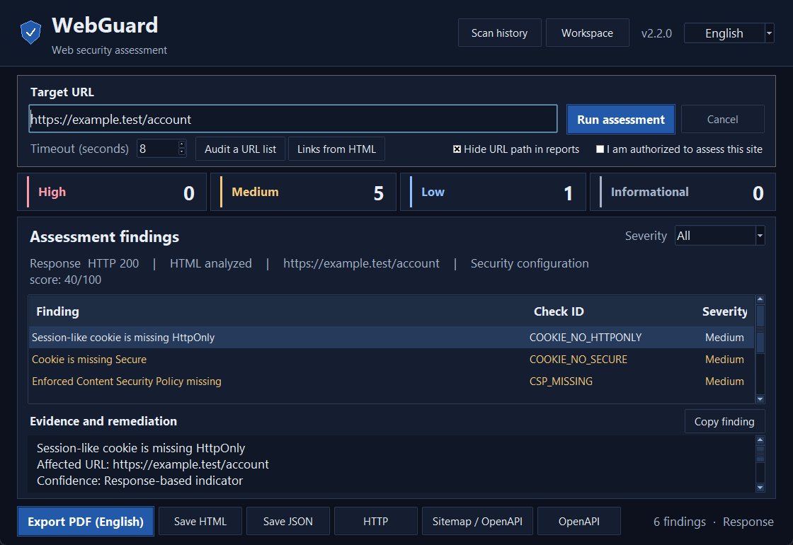

<h1 align="center">WebGuard</h1>
<p align="center">Web security configuration auditing for Windows</p>
<p align="center"><a href="../../releases/latest"><strong>Download WebGuard.exe</strong></a> · <a href="#quick-start">Quick start</a> · <a href="#build-and-test">Build and test</a></p>



*WebGuard 2.2.0 with demonstration results.*

## Quick start

1. Download **WebGuard.exe** for Windows x64 from [Releases](../../releases).
2. Enter a URL you are authorized to assess and run an assessment.
3. Select a finding to review its evidence, potential impact, and recommended fix. Use **HTTP** for redacted response evidence or export a report.

## Assessment workflow

| Task | What WebGuard provides |
| --- | --- |
| Define the scope | Assess one URL or review up to 50 same-origin URLs imported from saved Sitemap XML and OpenAPI 3 JSON files. |
| Inspect responses | Review TLS, security headers, cookies, CORS, HTML indicators, and the outcome for each URL. |
| Share findings | Export PDF, HTML, or JSON. The English workspace PDF includes a prioritized remediation plan. |
| Verify changes | Reopen a scan from SQLite history, compare observations, and record verification evidence. |
| Bring team evidence | Import JSON, CSV, and SARIF findings and retain their sources and status. |

Built-in observations are based on responses from the selected URLs. Authentication workflows and exploit verification are outside the built-in assessment scope. Findings from a team can be imported and tracked separately by source.

## Build and test

Use Python 3.13 with Tkinter on Windows.

```powershell
python -m pip install -r requirements-report.txt
python webguard_desktop.py
python -m unittest -v
```

Run `build_windows.bat` to build the standalone executable in `dist`. The v2.2.0 test suite contains **31 tests**, including nine labeled responses served by a local HTTP server.

## Local data

Scan history is stored in SQLite under `%LOCALAPPDATA%\WebGuard`. Review reports and imported evidence before sharing. Use the path privacy setting when the URL itself contains sensitive information.
